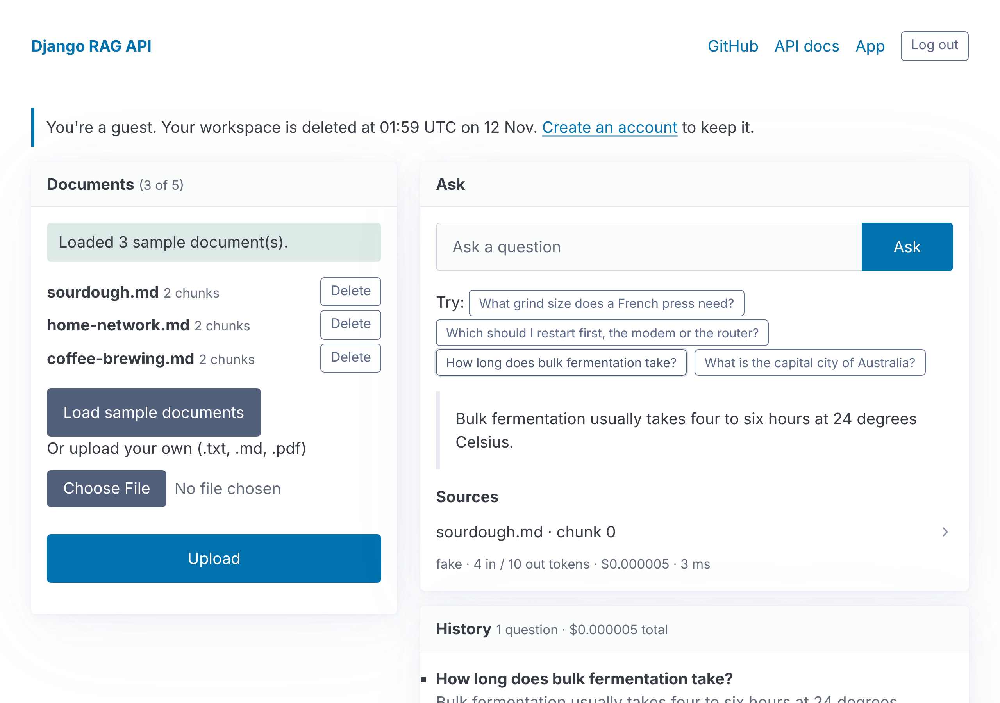
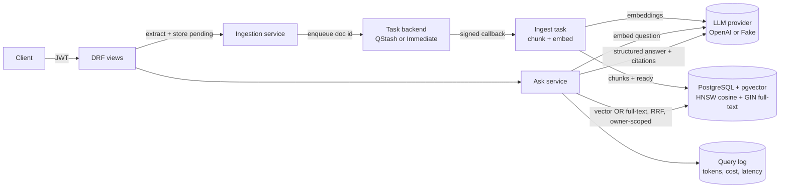

# Django RAG API

A small, production-shaped **document Q&A API**. Upload documents, then ask questions and get answers grounded in those documents, with citations back to the exact chunks used.

Built with Django, Django REST Framework, PostgreSQL + [pgvector](https://github.com/pgvector/pgvector), the OpenAI API and an HTMX web UI.

**Live demo:** [django-rag-api.onrender.com](https://django-rag-api.onrender.com/) (click "Try it as a guest"; free hosting, so the first load after an idle spell takes about 30 seconds).

[](https://github.com/davidyapcc/django-rag-api/actions/workflows/ci.yml)



## What it does

- **Auth:** registration plus JWT access/refresh tokens. Every document, chunk and query is scoped to its owner.
- **Ingestion:** upload `.txt`, `.md` or `.pdf`, then the API extracts text, stores the Document as `pending`, and enqueues an ingestion task (via Upstash QStash in production, `ImmediateBackend` locally and in tests). The task splits the text into overlapping chunks, embeds them and stores the vectors in Postgres (HNSW index, cosine distance) alongside a generated full-text column (GIN index), flipping the Document to `ready` in one transaction. Duplicate uploads are detected by SHA-256.
- **Ask:** **hybrid retrieval** for that user only: a chunk is a candidate if it is near the question's embedding **or** contains most of the question's terms (so exact names, codes and ids that embeddings miss still match), and reciprocal rank fusion orders the candidates. The LLM then answers using **structured output** (`answer` + `cited_chunk_ids`). Citations are checked against the retrieved set, so a hallucinated id never reaches the client.
- **Follow-ups:** a question can name one of the Owner's earlier Queries as its predecessor ("and the notice period?"). One extra model call rewrites it into a standalone question from the last 3 Queries in the chain (questions and answers, fenced as data), then retrieval and answering run unchanged on that question. Earlier answers never reach the answering model, so every answer still rests only on Chunks retrieved for it. The rewrite's tokens and cost count toward the Query, the Demo budget and the Allowance. See [ADR 0005](docs/adr/0005-follow-ups-rewrite-the-question.md).
- **Cost and usage logging:** every query records input/output/embedding tokens, USD cost and latency. `GET /queries/usage/` totals them.
- **Tracing (optional):** OpenTelemetry spans for each request, each pipeline stage (extract, chunk, embed, store; rewrite for a Follow-up, embed, retrieve, answer), every database query, and every OpenAI call (named and attributed per the GenAI semantic conventions: model, tokens, finish reason). Spans carry tokens, cost and distances, SQL with placeholders only, and never question, answer or document text, or titles. Off unless `OTEL_EXPORTER_OTLP_ENDPOINT` is set.
- **Error tracking (optional):** Sentry captures unhandled errors and logged exceptions with stack traces, tagged with the OpenTelemetry trace id so an error links to its trace. Events are scrubbed to the same rule as spans: exception messages, log arguments, request bodies, query strings and local variables never leave the service. Off unless `SENTRY_DSN` is set.
- **Guardrails:** relevance cut-offs on both retrieval gates mean the model is never called when nothing relevant is retrieved. Retrieved text is fenced and treated as data, not instructions (prompt-injection hygiene). There are per-user rate limits on `/ask` and uploads, and an upload size cap.
- **Web demo:** a server-rendered UI (Django templates + HTMX) with one-click **Guest** accounts that expire after 24 hours, **Sample documents** with suggested questions, and answers that expand to show the cited chunks and what the question cost.
- **Demo budget and Allowance:** a global cap on LLM spend per UTC day (`DEMO_DAILY_BUDGET_USD`, default USD 0.50), and each Owner's daily share of it (`ALLOWANCE_DAILY_USD`, default USD 0.10; `GUEST_ALLOWANCE_DAILY_USD`, USD 0.05 for Guests), so one person can't use up the demo for everyone. Once either is reached, new questions and uploads are declined until the next UTC day, through both the UI and the API.
- **Offline mode:** `LLM_PROVIDER=fake` swaps in a deterministic local provider, so tests, CI and the eval need no API key.

## Architecture



| Layer | Where |
| --- | --- |
| HTTP, validation, permissions, throttling | `apps/*/views.py`, `serializers.py` |
| Web UI (session auth, same services as the API) | `apps/web/` |
| Guests, the Demo budget and Allowances | `apps/accounts/services.py`, `apps/core/budget.py` |
| Business logic (ingest, retrieve, answer) | `apps/documents/services.py`, `apps/qa/services.py` |
| Push-queue task backend & QStash signature checks | `apps/documents/qstash.py` |
| Provider interface + OpenAI and Fake implementations | `rag/providers.py` |
| Chunking, extraction, pricing, pipeline spans | `rag/` |
| Tracing setup (off unless an OTLP endpoint is set) | `apps/core/tracing.py` |
| Error tracking setup and scrubbing (off unless `SENTRY_DSN` is set) | `apps/core/errors.py` |
| Golden-question eval | `evals/` |

## Web UI

`/` is the landing page. "Try it as a guest" creates a throwaway account and opens `/app/`, which has three panels: **Documents** (load samples, upload, delete), **Ask** (answer, expandable citations, tokens, cost and latency, and "Ask a follow-up", which shows the standalone question it searched for) and **History** (recent questions and total cost).

The pages use Django session login and call the same service functions as the API, so tenant isolation, citation checks, rate limits, the Demo budget and Allowances apply to both. Guests get smaller limits (5 documents, 500 KB per upload). Expired Guests are deleted whenever a new Guest is created, since the free host has no scheduler; `manage.py purge_guests` does the same on demand. The domain vocabulary lives in [`CONTEXT.md`](CONTEXT.md).

## API

Interactive docs are at `/api/docs/` (OpenAPI 3 via drf-spectacular).

| Method | Path | Purpose |
| --- | --- | --- |
| POST | `/api/v1/auth/register/` | Create account |
| POST | `/api/v1/auth/token/` | Get JWT pair |
| POST | `/api/v1/auth/token/refresh/` | Refresh access token |
| GET | `/api/v1/auth/me/` | Current user |
| GET / POST | `/api/v1/documents/` | List / upload (multipart `file`, optional `title`; returns `202` with `pending` -> `ready` \| `failed` status) |
| GET / DELETE | `/api/v1/documents/{id}/` | Retrieve / delete (cascades to chunks) |
| GET | `/api/v1/documents/{id}/chunks/` | Inspect how a document was chunked |
| POST | `/api/v1/ask/` | `{"question": "...", "document_ids": [..], "top_k": 5, "predecessor": 12}` (`predecessor` optional: makes it a Follow-up, 404 if it isn't your Query; `409` if `document_ids` includes a non-ready Document) |
| GET | `/api/v1/queries/` | Query history with citations and cost |
| GET | `/api/v1/queries/usage/` | Token and cost totals |
| GET | `/api/v1/health/` | Liveness + DB check |

Example:

```bash
curl -s -X POST localhost:8000/api/v1/ask/ \
  -H "Authorization: Bearer $TOKEN" -H "Content-Type: application/json" \
  -d '{"question": "How long does bulk fermentation take?"}'
```

```json
{
  "id": 13,
  "predecessor": null,
  "question": "How long does bulk fermentation take?",
  "standalone_question": null,
  "answer": "Bulk fermentation usually takes four to six hours at 24 degrees Celsius.",
  "citations": [{"chunk_id": 10, "document_id": 7, "document_title": "sourdough.md", "index": 0, "text": "..."}],
  "provider": "openai",
  "model": "gpt-6-luna",
  "input_tokens": 412,
  "output_tokens": 31,
  "embedding_tokens": 9,
  "cost_usd": "0.00005688",
  "latency_ms": 1180
}
```

A Follow-up returns the question as asked plus the `standalone_question` that retrieval and answering ran on.

## Run locally

Requires Python 3.12+, [uv](https://docs.astral.sh/uv/) and PostgreSQL 16 with pgvector (or Docker).

```bash
docker run -d --name ragdb -p 5432:5432 \
  -e POSTGRES_USER=app -e POSTGRES_PASSWORD=app -e POSTGRES_DB=ragapi pgvector/pgvector:pg16

cp .env.example .env          # LLM_PROVIDER=fake works with no key
uv sync
uv run python manage.py migrate
uv run python manage.py runserver
```

Set `LLM_PROVIDER=openai` and `OPENAI_API_KEY` in `.env` for real answers.

## Quality gates

```bash
uv run ruff check . && uv run ruff format --check .   # lint + format
uv run mypy .                                         # types (django-stubs, drf-stubs)
uv run pytest --cov                                   # tests, fails under 90% coverage
uv run python manage.py run_eval --verbose-cases      # golden-question eval
```

CI (GitHub Actions) runs all of these against a real pgvector Postgres service, checks for missing migrations, and builds the Docker image.

### The eval

`evals/` holds a small corpus and a golden set of questions, including one with no answer in the corpus. `run_eval` ingests the corpus for a throwaway user inside a rolled-back transaction, asks every question and scores:

| Metric | Meaning | Gate |
| --- | --- | --- |
| `retrieval_hit_rate` | source document is among retrieved chunks | ≥ 0.90 |
| `citation_precision` | cited chunks come from the right document | ≥ 0.90 |
| `answer_keyword_rate` | answer contains the expected facts | ≥ 0.75 |
| `abstain_rate` | unanswerable questions get no citations | 1.00 |

CI runs it with the offline provider, so a change to chunking, retrieval or the relevance cut-off that hurts quality fails the build. Run it with `LLM_PROVIDER=openai` to measure the real model and tune `RAG_MAX_DISTANCE`. Each run reports its own cost.

## Deploy (free tier: Render + Neon)

1. Create a free [Neon](https://neon.tech) Postgres project and copy its connection string (keep `?sslmode=require`). The first migration runs `CREATE EXTENSION vector`.
2. In OpenAI, create an API key and set a monthly usage limit.
3. On [Render](https://render.com): **New > Blueprint**, select this repo. `render.yaml` defines a free Docker web service. Fill in `DATABASE_URL` and `OPENAI_API_KEY` when prompted. The Demo budget defaults to USD 0.50 a day and each Owner's Allowance to USD 0.10 (USD 0.05 for Guests); change `DEMO_DAILY_BUDGET_USD`, `ALLOWANCE_DAILY_USD` and `GUEST_ALLOWANCE_DAILY_USD` to adjust them.
4. Create a free [Upstash QStash](https://upstash.com) project and set `QSTASH_TOKEN`, `QSTASH_CURRENT_SIGNING_KEY` and `QSTASH_NEXT_SIGNING_KEY` in Render (`render.yaml` sets `TASK_BACKEND=qstash`).
5. Migrations run on container start. Health check: `/api/v1/health/`.
6. Optional tracing: set `OTEL_EXPORTER_OTLP_ENDPOINT` (and `OTEL_EXPORTER_OTLP_HEADERS` for the backend's API key) to any OTLP/HTTP backend, such as Grafana Cloud or Honeycomb. `OTEL_SERVICE_NAME` defaults to `django-rag-api`. With no endpoint, tracing does nothing.
7. Optional error tracking: create a free [Sentry](https://sentry.io) project (platform Django) and set its DSN as `SENTRY_DSN`. Each deploy is tagged as a release from `RENDER_GIT_COMMIT`; `SENTRY_ENVIRONMENT` defaults to `production`. With no DSN, Sentry does nothing.

The free Render instance sleeps after 15 idle minutes, so the first request after a pause takes about a minute.

## Design decisions and trade-offs

- **pgvector instead of a separate vector database.** One datastore, transactional ingestion (a Document's Chunks and its `ready` status commit together or not at all), and owner filtering in the same SQL query as the similarity search. For this scale an HNSW index on Postgres is plenty.
- **Hybrid search with two gates, not one fused cut-off.** Each gate has its own relevance floor (vector distance, share of the question's terms) and fusion only orders what passed, so the model is still never called for an off-topic question. The full-text floor is a share of terms rather than `ts_rank_cd` because Postgres ranks have no IDF. See [ADR 0004](docs/adr/0004-hybrid-search-two-gates-and-a-coverage-floor.md).
- **`owner` denormalised onto `Chunk`.** Retrieval filters by owner without a join, and tenant isolation is enforced in the one query that matters. A composite foreign key to `Document(id, owner)` stops the copy from drifting from its document's owner.
- **Async ingestion through a push queue (QStash) with a 2 MB size cap.** Uploads validate and extract text inside the request, store the Document as `pending`, and enqueue chunking and embedding via Django's tasks framework. Production uses Upstash QStash so callbacks run over signed HTTP on the existing free web service with retries and no worker or broker; tests, CI, the eval and local dev use `ImmediateBackend` offline. Each callback is still one HTTP request, so the 2 MB upload cap stays. See [ADR 0006](docs/adr/0006-async-ingestion-through-a-push-queue.md).
- **Provider interface.** OpenAI and the fake provider implement the same three methods (`embed`, `answer`, `rewrite`). Swapping to another vendor is one class plus one setting. Each provider owns its relevance cut-off because embedding models differ in scale.
- **Structured output plus server-side citation validation.** JSON-schema output removes brittle parsing, and filtering cited ids against what was actually retrieved means the API never returns a citation it can't back up.
- **Spend tracked per day, in ledgers.** The Demo budget reads a `DailySpend` ledger and each Owner's Allowance an `OwnerDailySpend` ledger, rather than summing Queries and Documents, so deleting a Guest or a Document never hands budget back.
- **Allowance per day, not per month.** It shares the Demo budget's window: a monthly per-user cap wouldn't stop one Owner using up today's shared budget, and Guests only live 24 hours. Registering again gets a fresh Allowance, so the Demo budget stays the real backstop; the Allowance is about fairness.
- **Server-rendered UI over a separate SPA.** One deploy, no build step, and the UI reuses the service layer directly instead of re-implementing rules in JavaScript. HTMX and Pico.css are vendored as static files, so the page has no third-party runtime dependency.
- **Content-free telemetry.** Traces and error events go to third-party backends, outside the tenant boundary, so both carry ids, counts, tokens, cost and stack traces but never document or question text. That costs some debugging context (an exception's message is dropped, since provider and extraction errors can quote the input); the OpenTelemetry trace id on every Sentry event, and the Query log, recover most of it. Sentry's own performance tracing stays off so OpenTelemetry is the single source of traces.
- **No streaming.** Citations are checked once the whole answer exists, so streaming would show claims before they're verified. Answers are a few sentences, so there's little to gain. See [`.out-of-scope/streaming-answers.md`](.out-of-scope/streaming-answers.md).
- **Cost logged per request, prices in config.** Prices change, so they're environment variables rather than code.

## Roadmap

Considered and declined (reasons and what would reopen them are in [`.out-of-scope/`](.out-of-scope/)): streaming answers.

## License

MIT
