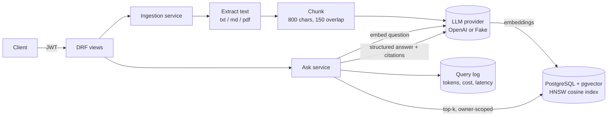

# Django RAG API

A small, production-shaped **document Q&A API**. Upload documents, then ask questions and get answers grounded in those documents, with citations back to the exact chunks used.

Built with Django, Django REST Framework, PostgreSQL + [pgvector](https://github.com/pgvector/pgvector), the OpenAI API and an HTMX web UI.

**Live demo:** [django-rag-api.onrender.com](https://django-rag-api.onrender.com/) (click "Try it as a guest"; free hosting, so the first load after an idle spell takes about 30 seconds).

[](https://github.com/davidyapcc/django-rag-api/actions/workflows/ci.yml)


## What it does

- **Auth:** registration plus JWT access/refresh tokens. Every document, chunk and query is scoped to its owner.
- **Ingestion:** upload `.txt`, `.md` or `.pdf`, then the API extracts text, splits it into overlapping chunks, embeds them and stores the vectors in Postgres (HNSW index, cosine distance). Duplicate uploads are detected by SHA-256.
- **Ask:** the question is embedded, the top-k nearest chunks are retrieved for that user only, and the LLM answers using **structured output** (`answer` + `cited_chunk_ids`). Citations are checked against the retrieved set, so a hallucinated id never reaches the client.
- **Cost and usage logging:** every query records input/output/embedding tokens, USD cost and latency. `GET /queries/usage/` totals them.
- **Guardrails:** a relevance cut-off means the model is never called when nothing relevant is retrieved. Retrieved text is fenced and treated as data, not instructions (prompt-injection hygiene). There are per-user rate limits on `/ask` and uploads, and an upload size cap.
- **Web demo:** a server-rendered UI (Django templates + HTMX) with one-click **Guest** accounts that expire after 24 hours, **Sample documents** with suggested questions, and answers that expand to show the cited chunks and what the question cost.
- **Demo budget:** a global cap on LLM spend per UTC day (`DEMO_DAILY_BUDGET_USD`, default USD 0.50). Once reached, new questions and uploads are declined until the next day, through both the UI and the API.
- **Offline mode:** `LLM_PROVIDER=fake` swaps in a deterministic local provider, so tests, CI and the eval need no API key.

## Architecture



| Layer | Where |
| --- | --- |
| HTTP, validation, permissions, throttling | `apps/*/views.py`, `serializers.py` |
| Web UI (session auth, same services as the API) | `apps/web/` |
| Guests and the Demo budget | `apps/accounts/services.py`, `apps/core/budget.py` |
| Business logic (ingest, retrieve, answer) | `apps/documents/services.py`, `apps/qa/services.py` |
| Provider interface + OpenAI and Fake implementations | `rag/providers.py` |
| Chunking, extraction, pricing | `rag/` |
| Golden-question eval | `evals/` |

## Web UI

`/` is the landing page. "Try it as a guest" creates a throwaway account and opens `/app/`, which has three panels: **Documents** (load samples, upload, delete), **Ask** (answer, expandable citations, tokens, cost and latency) and **History** (recent questions and total cost).

The pages use Django session login and call the same service functions as the API, so tenant isolation, citation checks, rate limits and the Demo budget apply to both. Guests get a smaller allowance (5 documents, 500 KB per upload). Expired Guests are deleted whenever a new Guest is created, since the free host has no scheduler; `manage.py purge_guests` does the same on demand. The domain vocabulary lives in [`CONTEXT.md`](CONTEXT.md).

## API

Interactive docs are at `/api/docs/` (OpenAPI 3 via drf-spectacular).

| Method | Path | Purpose |
| --- | --- | --- |
| POST | `/api/v1/auth/register/` | Create account |
| POST | `/api/v1/auth/token/` | Get JWT pair |
| POST | `/api/v1/auth/token/refresh/` | Refresh access token |
| GET | `/api/v1/auth/me/` | Current user |
| GET / POST | `/api/v1/documents/` | List / upload (multipart `file`, optional `title`) |
| GET / DELETE | `/api/v1/documents/{id}/` | Retrieve / delete (cascades to chunks) |
| GET | `/api/v1/documents/{id}/chunks/` | Inspect how a document was chunked |
| POST | `/api/v1/ask/` | `{"question": "...", "document_ids": [..], "top_k": 5}` |
| GET | `/api/v1/queries/` | Query history with citations and cost |
| GET | `/api/v1/queries/usage/` | Token and cost totals |
| GET | `/api/v1/health/` | Liveness + DB check |

Example:

```bash
curl -s -X POST localhost:8000/api/v1/ask/ \
  -H "Authorization: Bearer $TOKEN" -H "Content-Type: application/json" \
  -d '{"question": "How long does bulk fermentation take?"}'
```

```json
{
  "answer": "Bulk fermentation usually takes four to six hours at 24 degrees Celsius.",
  "citations": [{"chunk_id": 10, "document_id": 7, "document_title": "sourdough.md", "index": 0, "text": "..."}],
  "provider": "openai",
  "model": "gpt-6-luna",
  "input_tokens": 412,
  "output_tokens": 31,
  "embedding_tokens": 9,
  "cost_usd": "0.00005688",
  "latency_ms": 1180
}
```

## Run locally

Requires Python 3.12+, [uv](https://docs.astral.sh/uv/) and PostgreSQL 16 with pgvector (or Docker).

```bash
docker run -d --name ragdb -p 5432:5432 \
  -e POSTGRES_USER=app -e POSTGRES_PASSWORD=app -e POSTGRES_DB=ragapi pgvector/pgvector:pg16

cp .env.example .env          # LLM_PROVIDER=fake works with no key
uv sync
uv run python manage.py migrate
uv run python manage.py runserver
```

Set `LLM_PROVIDER=openai` and `OPENAI_API_KEY` in `.env` for real answers.

## Quality gates

```bash
uv run ruff check . && uv run ruff format --check .   # lint + format
uv run mypy .                                         # types (django-stubs, drf-stubs)
uv run pytest --cov                                   # tests, fails under 90% coverage
uv run python manage.py run_eval --verbose-cases      # golden-question eval
```

CI (GitHub Actions) runs all of these against a real pgvector Postgres service, checks for missing migrations, and builds the Docker image.

### The eval

`evals/` holds a small corpus and a golden set of questions, including one with no answer in the corpus. `run_eval` ingests the corpus for a throwaway user inside a rolled-back transaction, asks every question and scores:

| Metric | Meaning | Gate |
| --- | --- | --- |
| `retrieval_hit_rate` | source document is among retrieved chunks | ≥ 0.90 |
| `citation_precision` | cited chunks come from the right document | ≥ 0.90 |
| `answer_keyword_rate` | answer contains the expected facts | ≥ 0.75 |
| `abstain_rate` | unanswerable questions get no citations | 1.00 |

CI runs it with the offline provider, so a change to chunking, retrieval or the relevance cut-off that hurts quality fails the build. Run it with `LLM_PROVIDER=openai` to measure the real model and tune `RAG_MAX_DISTANCE`. Each run reports its own cost.

## Deploy (free tier: Render + Neon)

1. Create a free [Neon](https://neon.tech) Postgres project and copy its connection string (keep `?sslmode=require`). The first migration runs `CREATE EXTENSION vector`.
2. In OpenAI, create an API key and set a monthly usage limit.
3. On [Render](https://render.com): **New > Blueprint**, select this repo. `render.yaml` defines a free Docker web service. Fill in `DATABASE_URL` and `OPENAI_API_KEY` when prompted. The Demo budget defaults to USD 0.50 a day; change `DEMO_DAILY_BUDGET_USD` to adjust it.
4. Migrations run on container start. Health check: `/api/v1/health/`.

The free Render instance sleeps after 15 idle minutes, so the first request after a pause takes about 30 seconds.

## Design decisions and trade-offs

- **pgvector instead of a separate vector database.** One datastore, transactional ingestion (a document and all of its chunks commit together or not at all), and owner filtering in the same SQL query as the similarity search. For this scale an HNSW index on Postgres is plenty.
- **`owner` denormalised onto `Chunk`.** Retrieval filters by owner without a join, and tenant isolation is enforced in the one query that matters. A composite foreign key to `Document(id, owner)` stops the copy from drifting from its document's owner.
- **Synchronous ingestion with a size cap (2 MB).** It keeps the system simple and is correct on platforms that throttle CPU after a response is sent. The next step at scale would be a queue (Celery, or Cloud Tasks) with a `processing` status.
- **Provider interface.** OpenAI and the fake provider implement the same two methods (`embed`, `answer`). Swapping to another vendor is one class plus one setting. Each provider owns its relevance cut-off because embedding models differ in scale.
- **Structured output plus server-side citation validation.** JSON-schema output removes brittle parsing, and filtering cited ids against what was actually retrieved means the API never returns a citation it can't back up.
- **Spend tracked per day, apart from users.** The Demo budget reads a `DailySpend` ledger rather than summing users' queries, so deleting a Guest never hands budget back.
- **Server-rendered UI over a separate SPA.** One deploy, no build step, and the UI reuses the service layer directly instead of re-implementing rules in JavaScript. HTMX and Pico.css are vendored as static files, so the page has no third-party runtime dependency.
- **No streaming.** Citations are checked once the whole answer exists, so streaming would show claims before they're verified. Answers are a few sentences, so there's little to gain. See [`.out-of-scope/streaming-answers.md`](.out-of-scope/streaming-answers.md).
- **Cost logged per request, prices in config.** Prices change, so they're environment variables rather than code.

## Roadmap

In build order; each issue carries the agent brief.

1. Per-Owner daily Allowance ([#6](https://github.com/davidyapcc/django-rag-api/issues/6))
2. OpenTelemetry traces for each pipeline stage, with no document or question text in spans ([#7](https://github.com/davidyapcc/django-rag-api/issues/7))
3. Hybrid search: Postgres full-text + vector, reciprocal rank fusion ([#8](https://github.com/davidyapcc/django-rag-api/issues/8))
4. Follow-up questions that rewrite into a standalone question ([#9](https://github.com/davidyapcc/django-rag-api/issues/9))
5. Async ingestion through a push queue (QStash), so no worker is needed on the free host ([#11](https://github.com/davidyapcc/django-rag-api/issues/11)); can be built any time after #6

Considered and declined (reasons and what would reopen them are in [`.out-of-scope/`](.out-of-scope/)): streaming answers.

## License

MIT
